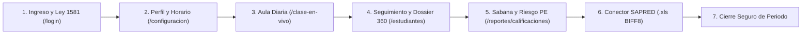

# Manual Oficial de Usuario — EduManager Premium Suite v2.17.0

**Institución Educativa Indígena Técnica Agroambiental Bilingüe Awá (`IETABA`)**  
Resguardo Awá Katsa Su · El Diviso · Barbacoas, Nariño · Adscrita a UNIPA  
**Versión de software documentada:** `v2.17.0` · **Asistente integrado:** `EduAwá`

---

## Contenido

1. [Visión General y Flujo de Trabajo](#1-visión-general-y-flujo-de-trabajo)
2. [Acceso, Activación de Cuentas, Ley 1581 y Roles](#2-acceso-activación-de-cuentas-ley-1581-y-roles)
3. [Dashboard Principal, Gobernanza y Analítica BI 360°](#3-dashboard-principal-gobernanza-y-analítica-bi-360)
4. [Motor Académico SIEEE y Primeros Puestos](#4-motor-académico-sieee-y-primeros-puestos)
5. [Clase en Vivo, Asistencia, Calificador y Cierre de Períodos](#5-clase-en-vivo-asistencia-calificador-y-cierre-de-períodos)
6. [Estudiantes, Ficha 360°, Dossiers en Lote y Cockpit de Grupo](#6-estudiantes-ficha-360-dossiers-en-lote-y-cockpit-de-grupo)
7. [Observador del Estudiante (Ley 1620) y Actas con 4 Firmas](#7-observador-del-estudiante-ley-1620-y-actas-con-4-firmas)
8. [Reportes de Calificaciones, Riesgo (PE) y Conector SAPRED 360° (.xls)](#8-reportes-de-calificaciones-riesgo-pe-y-conector-sapred-360-xls)
9. [Directorio Institucional de Docentes (Formato de 16 Columnas)](#9-directorio-institucional-de-docentes-formato-de-16-columnas)
10. [Consola Maestra de Administración (`/admin`)](#10-consola-maestra-de-administración-admin)
11. [Currículo y Tejido de Aprendizaje Awá (`/curriculo`)](#11-currículo-y-tejido-de-aprendizaje-awá-curriculo)
12. [Horario Semanal, Agenda Escolar y Configuración](#12-horario-semanal-agenda-escolar-y-configuración)
13. [Formatos Excel Oficiales (.xlsx) y Regla Institucional "Todo o Nada"](#13-formatos-excel-oficiales-xlsx-y-regla-institucional-todo-o-nada)
14. [Modo Offline-First Territorial (IndexedDB + PWA)](#14-modo-offline-first-territorial-indexeddb--pwa)
15. [Centro de Ayuda (`/ayuda`) y Asistente EduAwá](#15-centro-de-ayuda-ayuda-y-asistente-eduawá)
16. [Preguntas Frecuentes y Solución de Problemas](#16-preguntas-frecuentes-y-solución-de-problemas)

---

## 1. Visión General y Flujo de Trabajo

**EduManager Premium Suite** es una aplicación web progresiva (PWA) **Offline-First** construida específicamente para la gestión académica, convivencial, curricular y administrativa de **IETABA** en zonas con conectividad limitada o nula.

---

## 2. Acceso, Activación de Cuentas, Ley 1581 y Roles

### 2.1 Inicio de sesión (`/login`)
- **Continuar con Google:** método principal con cuenta institucional o autorizada.
- **Correo y contraseña:** acceso para cuentas creadas desde `/admin`, con opción **¿Olvidaste tu contraseña?** (envía enlace de recuperación).
- **Ingresar en Modo Local (Sin Internet):** por seguridad de datos de menores, este botón solo aparece cuando estás sin conexión **y existe una sesión previa guardada en el dispositivo**. Si es tu primer ingreso, debes conectarte a internet una vez.

### 2.2 Flujo obligatorio de primer ingreso
1. **Estado inicial `PENDING`:** toda cuenta nueva queda en pantalla **Acceso en Proceso** sin lectura ni escritura en base de datos hasta que Rectoría o un SuperAdmin active tu usuario en `/admin` → **Usuarios**.
2. **Acuerdo de Tratamiento de Datos (Ley 1581 de 2012):** debes leer el documento hasta el final para habilitar el botón **Acepto los términos y condiciones**.
3. **Configuración inicial (`/configuracion`):** los docentes activos sin perfil/horario completo son redirigidos automáticamente para registrar nombres, teléfono y malla horaria semanal.

### 2.3 Matriz de Roles Institucionales

| Rol | Alcance principal | Módulos exclusivos o ampliados |
|---|---|---|
| **SuperAdmin** | Gobierno técnico y funcional completo | Gestión de usuarios en `/admin`, activación de cuentas `PENDING`, auditoría, listas maestras y todos los módulos |
| **RECTOR** | Dirección institucional | `/admin` (estadísticas, maestros, estudiantes, docentes), `/directorio` (importar), `/reportes/*`, cierre de períodos |
| **COORDINADOR** | Gestión académica y convivencial | `/admin` (datos maestros e importaciones), `/directorio` (importar), `/curriculo`, `/estudiantes`, `/reportes/*` |
| **DOCENTE_DIRECTOR** | Docente con Dirección de Grupo asignada | Aulas asignadas + **Cockpit Director de Grupo 360°** en `/estudiantes` + importación en `/directorio` |
| **BIENESTAR** | Orientación y bienestar estudiantil | Dashboard, `/estudiantes` (Ficha 360° y Observador Ley 1620), `/clase-en-vivo`, `/directorio`, `/reportes/*` |
| **DOCENTE** | Docente de asignatura | Sus salones reales según `teachingCourses` y `weeklySchedule` en Dashboard, `/clase-en-vivo`, `/estudiantes`, `/curriculo`, `/horario`, `/agenda` |

> **Nota sobre equipos compartidos:** al terminar tu jornada en un computador institucional compartido, usa siempre **Cerrar sesión** en la barra superior para limpiar la caché local (`offline_user`, `edu_students`, `edu_directorio`, `edu_masterData`, etc.).

---

## 3. Dashboard Principal, Gobernanza y Analítica BI 360°

En `/` encuentras el centro ejecutivo de tu gestión:

- **Filtros Globales:** selecciona Grado y Curso para filtrar estadísticas, listados de riesgo y módulos conectados.
- **Tarjetas Bento de Gobernanza:**
  - **Pedagogía del Afecto:** lista cumpleaños del mes con botón directo de felicitación por WhatsApp.
  - **Equidad Institucional:** desglose de paridad por salón y género.
  - **Alerta Pedagógica (Extraedad):** identifica estudiantes con edad superior al estándar (`edad > Grado + 8 años`) con acceso a su Ficha 360° y Plan de Nivelación.
  - **Gobernanza Activa:** auditoría de cobertura por curso.
- **EduAI Sentinel v4.0 PRO y Centro de Analítica BI:**
  - Calcula en tiempo real distribución SIEEE (`Superior`, `Alto`, `Básico`, `Bajo`), promedios por saber, casos de deserción (*No asistieron y perdieron*) y cobertura curricular, sin datos simulados.
  - Gráficos interactivos: **Barras con meta aprobatoria `3.0`**, **Curva de evolución**, **Radar SIEEE de 5 pilares** y **Dona porcentual**, además de reporte BI imprimible 100% offline.
- **Primeros Puestos y Acumulado Multi-Período:**
  - Alterna el cuadro de honor entre `P1`, `P2`, `P3` o `Final (3P)` y revisa alertas tempranas cuando un estudiante aprueba en promedio pero reprueba una asignatura específica.

---

## 4. Motor Académico SIEEE y Primeros Puestos

El archivo `src/lib/gradeUtils.ts` unifica todas las fórmulas en la suite:

| Pilar / Dimensión | Sigla | Peso SIEEE | Capacidad de casillas |
|---|---|---|---|
| **Saber** (Exámenes, sustentaciones) | `SB` | **30%** | 8 casillas (`SB1..SB8`) |
| **Saber-Hacer** (Talleres, prácticas) | `SBH` | **40%** | 8 casillas (`SBH1..SBH8`) |
| **Ser** (Actitud, identidad Awá) | `SR` | **20%** | 5 casillas (`SR1..SR5`) |
| **Convivencia** (Pacto de aula) | `CV` | **5%** | 3 casillas (`CV1..CV3`) |
| **Autoevaluación** | `AUT` | **5%** | 1 casilla (`AUT`) |
| **Recuperación / Nivelación** | `REC` | Reemplaza parcial | 1 casilla (`REC`) |

### Reglas matemáticas oficiales
1. **Normalización sobre pilares calificados:** si el período está en curso y solo hay notas en `SB` (4.0) y `SBH` (4.0), se divide entre la suma de esos pesos (`70%`), obteniendo `4.00` real (no `2.8`).
2. **Conservación del `0.0` real:** una calificación de `0.0` ingresada explícitamente cuenta como nota evaluada; solo las celdas vacías (`null`) quedan excluidas de la media parcial.
3. **Recuperación (`REC`):** cuando se registra `REC`, esta reemplaza la nota parcial del período.
4. **Cierre anual (3 períodos):** cada período pesa `1/3`: `Nota Final Anual = (P1 + P2 + P3) / 3`. Si el grupo ya evaluó un período y un estudiante no tiene nota en él, ese período cuenta como `0.0` en el acumulado.
5. **Escala valorativa (aprobación `≥ 3.0`):**
   - `4.6 – 5.0` → **Superior**
   - `4.0 – 4.5` → **Alto**
   - `3.0 – 3.9` → **Básico**
   - `1.0 – 2.9` → **Bajo** (requiere Plan de Nivelación)
6. **Primeros Puestos (`1-2-2-4`):** ordena por promedio del alcance seleccionado -> desempate por acumulado anual (o período activo) -> menor número de inasistencias. Los empates exactos a 2 decimales comparten el mismo puesto.

---

## 5. Clase en Vivo, Asistencia, Calificador y Cierre de Períodos

Ubicación: `/clase-en-vivo`.

### 5.1 Selección de salón y borradores locales
- Elige **Asignatura**, **Grado** y **Curso**, o pulsa directamente uno de los botones rápidos de tus salones asignados.
- Si sales sin guardar una asistencia o actividad, aparecerá un indicador de **Borradores pendientes** (`draft_attendance_*` / `draft_activity_*`) para retomarlo o descartarlo con un clic.

### 5.2 Modo Clase en Vivo (`live`)
- **Asistencia en 1 toque:** usa **Marcar Todos Presentes** y marca solo excepciones (`Presente`, `Ausente`, `Tarde`, `Excusado`). Al superar el 20% de fallas se activa alerta preventiva y citación WhatsApp.
- **Herramientas dinámicas:** **Ruleta de Participación** y **Cronómetro de Aula**.
- **Calificador de Actividades (`ActivityGrader`):** selecciona pilar y casilla, asigna un **título descriptivo obligatorio**, ingresa notas (con teclado rápido o tabla) y guarda optimísticamente.
- **Bitácora de Sesión y Recordatorios:** notas con autoguardado conectadas a `/agenda` y seguimiento al Tejido Curricular del día.

### 5.3 Modo Planilla / Gradebook (`gradebook`) y Cierre Seguro
- Descarga la **Planilla Oficial SIEEE (.xlsx)** del curso (prellenada con tus estudiantes y notas actuales, incluyendo `REC`) o el formato ejemplo.
- Importa planillas completadas bajo validación **"Todo o Nada"** con vista previa de aprobados/riesgo antes de consolidar en `p1`, `p2` o `p3`.
- **Cerrar Período:** activa el **Modal de Seguridad Académica** con 3 casillas obligatorias de verificación para bloquear modificaciones accidentales del período.

---

## 6. Estudiantes, Ficha 360°, Dossiers en Lote y Cockpit de Grupo

Ubicación: `/estudiantes`.

- **Filtros y tarjetas KPI:** toca **Promedio Grupal**, **Estudiantes Activos**, **En Riesgo Académico** o **Desempeño Superior** para filtrar la lista inmediatamente.
- **Ficha 360° del Estudiante (`StudentProfile`):**
  - **Dossier 360° (PDF):** selecciona **`Periodo 1`**, **`Periodo 2`**, **`Periodo 3`** o **`Final (3 Períodos)`** y genera el informe ejecutivo (períodos sin calificaciones muestran `—`, con cero datos ficticios).
  - **Dossiers en Lote (`Dossiers Lote`):** imprime todos los estudiantes filtrados en un único documento multipágina, listo para entregar boletines, nombrado bajo ISO 15489 (`IETABA_..._YYYYMMDD`).
  - **Edición directa:** pulsa la insignia de estado de matrícula para gestionar retiros/traslados/estados (`StudentStatusModal`) o **Editar Acudiente** (`GuardianModal`) para actualizar acudiente, parentesco y WhatsApp.
- **Cockpit Director de Grupo 360°:** habilitado para `DOCENTE_DIRECTOR`, `RECTOR` y `COORDINADOR`. Ofrece **Matriz de Calor Multimateria**, tasas de promoción, puestos por período y final, alertas de riesgo crítico (`≥ 3` asignaturas perdidas) y citación WhatsApp en 1 clic.

---

## 7. Observador del Estudiante (Ley 1620) y Actas con 4 Firmas

Desde la Ficha 360° (en `/estudiantes` o en modales de perfil):

1. Abre la pestaña **Observador / Convivencia** → **Nueva Observación**.
2. Selecciona la tipificación: **Positiva (Felicitación)**, **Tipo I (Leve)**, **Tipo II (Grave)** o **Tipo III (Gravísima)**.
3. Registra la descripción objetiva, **descargos del estudiante** y compromisos pedagógicos.
4. Opcionalmente marca si aplica ajuste automático a la dimensión **Ser (`SR`)** o **Convivencia (`CV`)** del período activo.
5. Pulsa **Acta Compromiso (PDF)** para imprimir el documento formal con historial y 4 recuadros de firma (*Docente/Director de Grupo, Coordinador Académico, Estudiante y Acudiente*).

---

## 8. Reportes de Calificaciones, Riesgo (PE) y Conector SAPRED 360° (.xls)

Ubicación: `/reportes/calificaciones` (y consolidado de asistencia en `/reportes/asistencia`).

### 8.1 Sábana interactiva y ordenamiento
- Edita celdas directamente (`SB1..8`, `SBH1..8`, `SR1..5`, `CV1..3`, `AUT`, `REC`) con recálculo SIEEE inmediato en `PARC` y `DEF`.
- Alterna entre **`Orden: SAPRED`** (respeta el orden exacto de fila de las planillas SAPRED guardadas por salón) y **`Orden: A-Z`**.
- Exporta la matriz completa en Excel nativo (`.xlsx` con SheetJS) o imprime la Sábana Auxiliar.

### 8.2 Reporte Oficial de Estudiantes Perdiendo y Sin Notas (`PE`)
Pulsa **Riesgo y Sin Notas (PE)** y selecciona uno de los **4 alcances**:
- `Esta Materia (Período)` / `Esta Materia (Final P1-P3)`
- `Asig. Docente (Período)` / `Asig. Docente (Final P1-P3)` (cruza tu horario real para evaluar solo las materias que dictas en cada salón)

El informe separa en **2 tablas**:
1. **Tabla 1 (`🔴 PERDIENDO` / `🟡 MATERIA PERDIDA`):** solo estudiantes con notas registradas reprobando (`< 3.00`).
2. **Tabla 2 (`⚪ PE — Pendiente por Evaluar`):** estudiantes sin calificaciones registradas aún.

### 8.3 Conector SAPRED 360° (`.xls` BIFF8 Multi-Hoja)
Pulsa **Conector SAPRED (.xls)**:
- **Flujo 1 — Llenar Plantilla SAPRED (`.xls`):**
  1. Sube el archivo `.xls` descargado de SAPRED (1 o múltiples hojas como `5-1__TPI`, `6-6__FIS`, `8-3__TPI`).
  2. El conector corrige automáticamente mojibake/tildes, identifica materia/salón y cruza por `CODIGO` (`nroDocumento`).
  3. **Auditoría "Todo o Nada":** detecta novedades (`FALTA_EN_SAPRED`, `NO_EXISTE_EN_EDUMANAGER`, `CAMBIO_DE_SALON`, `DATOS_MODIFICADOS`, `CODIGO_DUPLICADO`, `CODIGO_VACIO`). Si hay errores bloqueantes impide la descarga y genera **Reporte de Novedades (.xlsx)**. En discrepancias de nombres ofrece sincronizar datos desde SAPRED.
  4. Al aprobar, descarga el `.xls` diligenciado hasta la columna `AUT` (preservando `0.0` real, sin modificar orden ni añadir `PARC/REC/DEF`) y guarda el orden `sapredOrder`.
- **Flujo 2 — Exportar `.XLS` Multi-Hoja (SAPRED):** exporta libros `.xls` BIFF8 listos para SAPRED por la materia seleccionada o por todos los salones/materias de tu horario.

---

## 9. Directorio Institucional de Docentes (Formato de 16 Columnas)

Ubicación: `/directorio` (y pestaña Docentes de `/admin`).

- **Consulta y contacto rápido:** combina las cuentas registradas (`users`) y las fichas institucionales (`directorio`) con respaldo offline en `localStorage["edu_directorio"]`. Filtra por rol, estado o dirección de grupo y contacta por **WhatsApp**, **llamada** o **correo** en 1 clic.
- **Carga masiva y plantilla oficial de 16 columnas** (habilitada para `RECTOR`, `COORDINADOR`, `DOCENTE_DIRECTOR` y `SuperAdmin`):

| Col | Encabezado exacto | Obligatorio | Valores / Reglas de validación |
|---|---|---|---|
| 1 | `TIPO DOC.` | Opcional | Por defecto `C.C.` (`C.E.`, `T.I.`, `PASAPORTE`) |
| 2 | `NRO DOCUMENTO` | **Sí (Único)** | Identifica `/directorio/staff-<documento>`; bloquea duplicados |
| 3 | `PRIMER APELLIDO` | **Sí** | Obligatorio |
| 4 | `SEGUNDO APELLIDO` | Opcional | Texto |
| 5 | `PRIMER NOMBRE` | **Sí** | Obligatorio |
| 6 | `SEGUNDO NOMBRE` | Opcional | Texto |
| 7 | `CORREO ELECTRONICO` | **Sí (Único)** | Formato email válido y único en el archivo |
| 8 | `TELEFONO / WHATSAPP` | Recomendado | Solo dígitos; `< 7` dígitos genera alerta |
| 9 | `ROL INSTITUCIONAL` | **Sí** | `RECTOR`, `COORDINADOR`, `BIENESTAR`, `DOCENTE`, `DOCENTE_DIRECTOR` |
| 10 | `ES DIRECTOR DE GRUPO` | Recomendado | `SI` o `NO` (si es `SI` o `DOCENTE_DIRECTOR` exige Grado y Curso) |
| 11 | `GRADO DIRECTOR` | **Si es Director** | Ej. `6°`, `7°`, `10°` |
| 12 | `CURSO DIRECTOR` | **Si es Director** | Ej. `1`, `2`, `A` |
| 13 | `ASIGNATURAS` | Recomendado | Separadas por coma (ej. `TECNOLOGÍA, FÍSICA`) |
| 14 | `CURSOS ASIGNADOS` | Recomendado | Separados por coma (ej. `5-1, 5-2, 6-3`) |
| 15 | `SEDE / AREA` | Opcional | Sede o área institucional |
| 16 | `ESTADO` | **Sí** | `ACTIVO` o `INACTIVO` (`ACTIVO` por defecto) |

> Si existe al menos 1 error bloqueante, se detiene toda la importación y se descarga un **Reporte de Novedades Excel (.xlsx)** con la fila, columna y motivo exacto. También puedes usar **Exportar Excel** para descargar todo el directorio actualizado.

---

## 10. Consola Maestra de Administración (`/admin`)

Acceso exclusivo para **`RECTOR`**, **`COORDINADOR`** y **`SuperAdmin`**:

- **Estadísticas y Asistencia Analítica:** métricas globales institucionales y control de inasistencias críticas.
- **Gestión de Datos Maestros (`teachers`, `subjects`, `grades`, `courses`):** agregar, editar o eliminar ítems individuales sincronizando en Firestore `settings/masterData` (borrado masivo deshabilitado por seguridad).
- **Importaciones Maestras:**
  - En **Estudiantes**: usa el formato oficial SIMAT de 16 columnas bajo Regla "Todo o Nada".
  - En **Docentes**: descarga la plantilla oficial de 16 columnas e importa archivos estructurados directo a `/directorio` + `masterData.teachers` (con soporte retrocompatible de listados simples de 1 columna).
- **Gestión de Usuarios (solo `SuperAdmin`):**
  - Activa cuentas en estado `PENDING` asignando su rol institucional (`DOCENTE`, `DOCENTE_DIRECTOR`, `BIENESTAR`, `COORDINADOR`, `RECTOR`).
  - Crea nuevos usuarios con correo y contraseña segura (`≥ 8` caracteres, mayúscula y número) usando una sesión aislada temporal que **no cierra la sesión del administrador**.

---

## 11. Currículo y Tejido de Aprendizaje Awá (`/curriculo`)

- **Estructura v2:** organiza los 3 períodos (`Periodo 1`, `Periodo 2`, `Periodo 3`) con barra lateral de avance (`X/Y temas`). Cada unidad resalta la **Higra del Conocimiento (`Tuh Putkamna`)** como título central, sus **Temas de la Higra** marcables en clase y los **Hilos del Saber (`Piankammu Mi`: SABER, HACER, SER)** junto con **Pañapain** (saberes propios), **Ñanpaskas** (interculturales) y **Sat Ishkit Kamtana** (Tejiendo Aprendo).
- **Herramientas Pedagógicas:**
  - **Copiloto de Lecciones IA:** genera desarrollo de clase, taller de aplicación, actividad lúdica y evaluación listas para imprimir.
  - **Adaptación Curricular PIAR:** flexibiliza objetivos para ritmo lento, limitación visual/auditiva o bilingüismo Awapit–Español.
  - **Lecturas del Tejido & Radar de Competencias:** material de comprensión y balance ancestral/agroambiental/universal.
  - **Importador de Tejidos (.xlsx):** carga planes curriculares bajo Regla "Todo o Nada".

---

## 12. Horario Semanal, Agenda Escolar y Configuración

- **Horario (`/horario` y `/configuracion`):** visualiza tus bloques de lunes a viernes, descarga la **plantilla Excel de 30 franjas** (excluye automáticamente el descanso oficial `10:30 – 11:00`) e importa tu malla. Antes de guardar, el sistema verifica en Firestore (`verifyScheduleCollisionsInFirestore`) que no haya otro docente en el mismo salón y franja horaria.
- **Agenda Escolar (`/agenda`):** organiza compromisos como **Tarea (`TASK`)**, **Sin Clase (`NO_CLASS`)** o **Nota General (`GENERAL`)** en vistas **Línea de Tiempo**, **Tablero Kanban** y **Semanal**, con selección múltiple para acciones por lotes.
- **Respaldo Local (`/configuracion`):** exporta una copia local de seguridad de tus datos mediante `DatabaseBackup`.

---

## 13. Formatos Excel Oficiales (.xlsx) y Regla Institucional "Todo o Nada"

Todas las cargas masivas aceptan `.xlsx`, `.xls` y `.csv` procesados localmente mediante SheetJS:

| Formato Oficial | Módulo de descarga / carga | Validaciones bloqueantes ("Todo o Nada") |
|---|---|---|
| **Matrícula SIMAT (16 cols)** | `/estudiantes` y `/admin → Estudiantes` | Documento único, nombre/apellido, grado/curso, fecha ISO o serial Excel, género, parentesco y estado |
| **Directorio Docentes (16 cols)** | `/directorio` y `/admin → Docentes` | Documento y correo únicos, formato de email, rol válido, estado y Grado/Curso si es Director |
| **Planilla SIEEE (SB..REC)** | `/clase-en-vivo → Gradebook` | Códigos existentes en el curso activo, duplicados y notas numéricas estrictas en `0.0 – 5.0` |
| **Malla Horaria (30 franjas)** | `/configuracion` y `/horario` | Días hábiles, franjas válidas, descanso bloqueado y **colisiones de salón/hora en Firestore** |
| **Tejido Awá** | `/curriculo` | Grado, Materia, Período `1–3`, Higra no duplicada, Temas de la Higra e Hilos SABER/HACER/SER |

Ante cualquier falla, **0 registros se guardan o alteran** y descargas de inmediato el **Reporte de Novedades (.xlsx)** para corregir exactamente las filas señaladas.

---

## 14. Modo Offline-First Territorial (IndexedDB + PWA)

1. **Preparación antes de viajar al resguardo/vereda:** abre EduManager con conexión a internet, inicia sesión y permite que carguen estudiantes, currículo, directorio y datos maestros (quedan almacenados en **Firestore IndexedDB `persistentLocalCache`** y **`localStorage`**).
2. **Trabajo sin internet:** todas las calificaciones, asistencias, observaciones convivenciales, cambios de agenda y cargas locales se aplican de forma optimista en **0ms** sin congelar la interfaz.
3. **Fallback PWA:** si abres la app instalada sin conexión en una ruta no cacheada, la vista `/~offline` te permite recuperar la sesión sin perder el trabajo.
4. **Sincronización automática:** al detectar red WiFi o datos móviles, la notificación superior (`OfflineToast`) confirma el regreso en línea y Firestore sincroniza automáticamente la cola pendiente.

---

## 15. Centro de Ayuda (`/ayuda`) y Asistente EduAwá

- **Centro de Ayuda (`/ayuda`):** incluye el **Simulador Interactivo SIEEE** (ahora con casilla y deslizador para simular **Recuperación `REC`** en vivo), buscador de guías filtrables por 11 categorías y sección de Preguntas Frecuentes.
- **Chatbot Flotante `EduAwá`:** disponible en la esquina inferior derecha tras iniciar sesión:
  - **Pestaña Chat IA:** reconoce lenguaje natural y dictado por voz (`es-CO`) sobre SIEEE, SAPRED, Directorio 16 columnas, Todo o Nada Excel, Primeros Puestos, Riesgo `PE`, Analítica Extraedad, Dossier 360°, Roles/PENDING, Observador Ley 1620, Tejido Awá y Modo Offline.
  - **Sugerencias Contextuales:** cambian dinámicamente según el módulo donde estés (`/directorio`, `/admin`, `/reportes`, `/estudiantes`, `/clase-en-vivo`, `/curriculo`, `/horario`, `/configuracion`).
  - **Atajos, Guías y FAQ:** acceso directo en 1 clic a los módulos clave, búsqueda offline en todas las guías y preguntas frecuentes.

---

## 16. Preguntas Frecuentes y Solución de Problemas

| Situación | Causa y solución recomendada |
|---|---|
| Veo la pantalla **"Acceso en Proceso"** | Tu cuenta está en estado `PENDING`. Solicita a Rectoría o SuperAdmin activarla y asignarte rol en `/admin` → Usuarios. |
| No aparece **"Ingresar en Modo Local"** en `/login` | Por seguridad solo se muestra sin internet si ya iniciaste sesión antes en ese dispositivo y navegador. Conéctate una vez para habilitar caché local. |
| Un estudiante nuevo aparece en **`FALTA_EN_SAPRED`** | Matricula o actualiza el estudiante en SAPRED primero, o descarga el `.xls` actualizado de SAPRED antes de ejecutar el Conector SAPRED. |
| No veo un curso en **`Estudiantes`** o **`Clase en Vivo`** | Verifica en `/configuracion` que tu `weeklySchedule` o `teachingCourses` incluya exactamente ese grado y curso (`ej. 6-1`). |
| Una calificación `4.0` no se ve con **`2.8`** en reportes | Asegúrate de tener la versión `v2.17.0` donde `gradeUtils.ts` y `printService.ts` normalizan exclusivamente sobre pilares evaluados. |
| El Excel no carga y sale **"Carga Bloqueada"** | Descarga el **Reporte de Novedades (.xlsx)** desde el mismo modal, corrige la fila/columna exacta indicada y vuelve a subir el archivo. |
